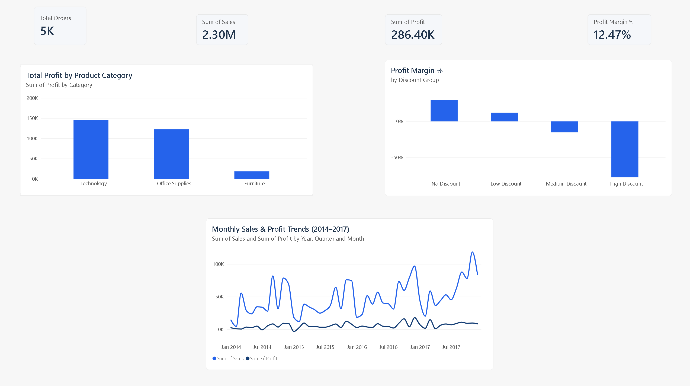

# Superstore-Sales-Analysis

## About the Project

I used the Sample Superstore dataset to analyze sales and profitability between 2014 and 2017.

I worked with PostgreSQL to explore the data and answer questions about sales performance, discounts, product categories, and customer purchasing behavior. I then built a Power BI dashboard to visualize the main results.

The dataset contains 9,994 sales records.

## Tools

- **PostgreSQL** – SQL analysis
- **DBeaver** – Running and managing SQL queries
- **Power BI** – Data visualization and dashboard creation
- **DAX** – Calculated measures and discount groups

## SQL Analysis

I wrote nine SQL queries covering:

1. Overall sales, profit, and profit margin
2. Sales and profitability by product category
3. Profitability by product subcategory
4. The relationship between discounts and profitability
5. Monthly sales, profit, and order trends
6. Top 10 customers by total spending
7. One-time vs. repeat customers
8. Month-over-month profit changes
9. Profitability by category and discount group

The queries include aggregations, `CASE WHEN`, subqueries, CTEs, and window functions such as `LAG()`.

The SQL code is available in [analysis.sql](analysis.sql).

## Power BI Dashboard

I created a dashboard to summarize the results and make it easier to compare different parts of the business.

It includes four main metrics: total sales, total profit, profit margin, and total orders.

The dashboard also shows monthly sales and profit trends, profit by product category, and profit margin across discount groups.

## Main Findings

**Overall performance**

Total sales were approximately $2.30M, with $286.4K in profit and an overall profit margin of 12.47%.

**Product categories**

Technology generated the highest total profit, followed by Office Supplies. Furniture had the lowest total profit.

**Discounts**

The medium and high discount groups had negative profit margins, with the high discount group performing the worst.

This suggests that transactions with larger discounts are worth examining more closely, although discounts may not be the only factor affecting profitability.

**Customer behavior**

Most customers placed more than one order during the period covered by the dataset.

**Sales trends**

Monthly sales fluctuated throughout the four years, but the overall trend was upward.

## Final Thoughts

One thing that stood out to me was the difference between sales and profitability. Looking only at revenue can hide problems, especially when discounts are involved.

This project helped me practice writing SQL queries, working with business metrics, and presenting the results in Power BI.

## Project Files

- [analysis.sql](analysis.sql) – SQL queries
- [Power BI Dashboard](Superstore_Sales_Analysis.pbix) – Power BI report file
- [dashboard.png](dashboard.png) – Dashboard screenshot

## Dataset

Sample Superstore dataset, covering retail transactions from 2014 to 2017.

This project uses sample data for learning and portfolio purposes.
